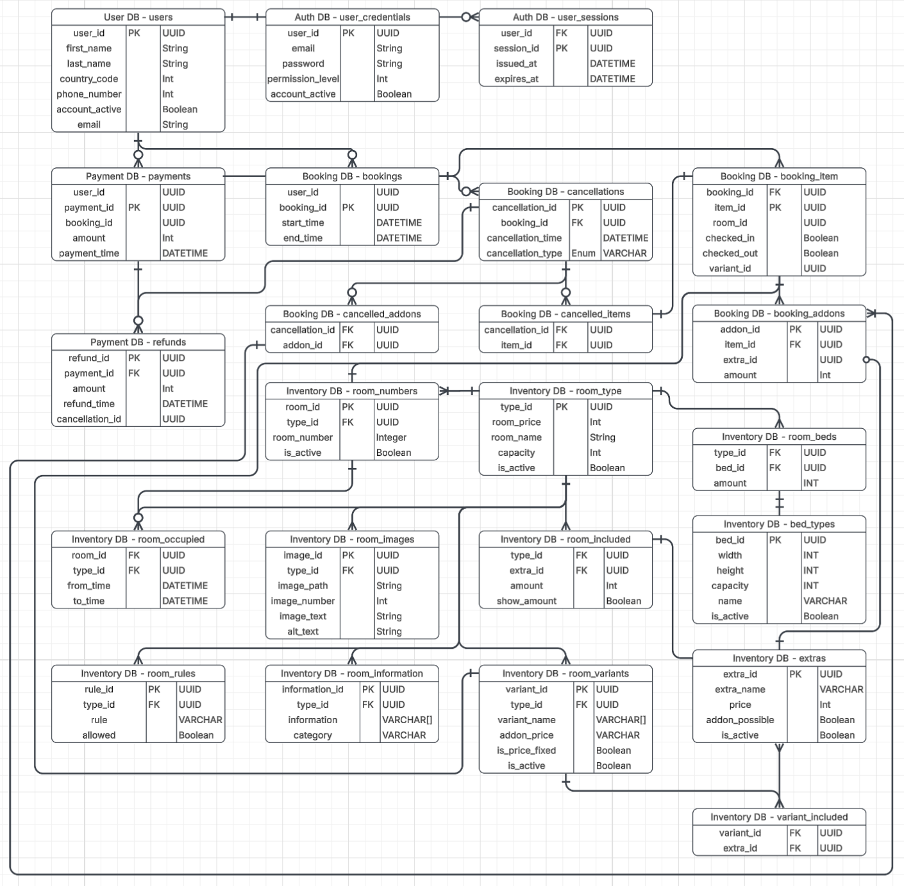

# Database scemas
This document contains the tables (with which content) the databases should have.

<table>
  <tr>
    <th rowspan="9">User DB</th>
    <th colspan="2">users</th>
  </tr>
  <tr>
    <th>Column name</th><th>Data type</th>
  </tr>
  <tr>
    <td>user_id</td><td>PK, UUID</td>
  </tr>
  <tr>
    <td>first_name</td><td>VARCHAR</td>
  </tr>
  <tr>
    <td>last_name</td><td>VARCHAR</td>
  </tr>
  <tr>
    <td>country_code</td><td>INT</td>
  </tr>
  <tr>
    <td>Phone number</td><td>INT</td>
  </tr>
  <tr>
    <td>email</td><td>VARCHAR</td>
  </tr>
  <tr>
    <td>is_active</td><td>BOOLEAN</td>
  </tr>
</table>

<table>
  <tr>
    <th rowspan="7">Auth DB</th>
    <th colspan="2">user_credentials</th>
    <th colspan="2">user_sessions</th>
  </tr>
  <tr>
    <th>Column name</th><th>Data type</th>
    <th>Column name</th><th>Data type</th>
  </tr>
  <tr>
    <td>user_id</td><td>PK, UUID</td>
    <td>user_id</td><td>FK, UUID</td>
  </tr>
  <tr>
    <td>email</td><td>VARCHAR</td>
    <td>session_id</td><td>PK, UUID</td>
  </tr>
  <tr>
    <td>password</td><td>VARCHAR</td>
    <td>issued_at</td><td>DATETIME</td>
  </tr>
  <tr>
    <td>permission_level</td><td>INT</td>
    <td>expires_at</td><td>DATETIME</td>
  </tr>
  <tr>
    <td>is_active</td><td>BOOLEAN</td>
    <td></td><td></td>
  </tr>
</table>

<table>
  <tr>
    <th rowspan="7">Payment DB</th>
    <th colspan="2">payments</th>
    <th colspan="2">refunds</th>
  </tr>
  <tr>
    <th>Column name</th><th>Data type</th>
    <th>Column name</th><th>Data type</th>
  </tr>
  <tr>
    <td>user_id</td><td>UUID</td>
    <td>refund_id</td><td>PK, UUID</td>
  </tr>
  <tr>
    <td>payment_id</td><td>PK, UUID</td>
    <td>payment_id</td><td>FK, UUID</td>
  </tr>
  <tr>
    <td>booking_id</td><td>UUID</td>
    <td>amount</td><td>INT</td>
  </tr>
  <tr>
    <td>amount</td><td>INT</td>
    <td>refund_time</td><td>DATETIME</td>
  </tr>
  <tr>
    <td>payment_time</td><td>DATETIME</td>
    <td>cancellation_id</td><td>UUID</td>
  </tr>
</table>

<table>
  <tr>
    <th rowspan="8">Booking DB</th>
    <th colspan="2">bookings</th>
    <th colspan="2">booking_items</th>
    <th colspan="2">cancellations</th>
    <th colspan="2">cancelled_addons</th>
    <th colspan="2">cancelled_items</th>
    <th colspan="2">booking_addons</th>
  </tr>
  <tr>
    <th>Column name</th><th>Data type</th>
    <th>Column name</th><th>Data type</th>
    <th>Column name</th><th>Data type</th>
    <th>Column name</th><th>Data type</th>
    <th>Column name</th><th>Data type</th>
    <th>Column name</th><th>Data type</th>
  </tr>
  <tr>
    <td>user_id</td><td>UUID</td>
    <td>booking_id</td><td>FK, UUID</td>
    <td>cancellation_id</td><td>PK, UUID</td>
    <td>cancellation_id</td><td>FK, UUID</td>
    <td>cancellation_id</td><td>FK, UUID</td>
    <td>addon_id</td><td>PK, UUID</td>
  </tr>
  <tr>
    <td>booking_id</td><td>PK, UUID</td>
    <td>item_id</td><td>PK, UUID</td>
    <td>booking_id</td><td>FK, UUID</td>
    <td>addon_id</td><td>FK, UUID</td>
    <td>item_id</td><td>FK, UUID</td>
    <td>item_id</td><td>FK, UUID</td>
  </tr>
  <tr>
    <td>start_time</td><td>DATETIME</td>
    <td>room_id</td><td>room_id</td>
    <td>cancellation_time</td><td>DATETIME</td>
    <td></td><td></td>
    <td></td><td></td>
    <td>extra_id</td><td>UUID</td>
  </tr>
  <tr>
    <td>end_time</td><td>DATETIME</td>
    <td>checked_in</td><td>BOOLEAN</td>
    <td>cancellation_type</td><td>VARCHAR(enum)</td>
    <td></td><td></td>
    <td></td><td></td>
    <td>amount</td><td>INT</td>
  </tr>
  <tr>
    <td></td><td></td>
    <td>checked_out</td><td>BOOLEAN</td>
    <td></td><td></td>
    <td></td><td></td>
    <td></td><td></td>
    <td></td><td></td>
  </tr>
  <tr>
    <td></td><td></td>
    <td>variant_id</td><td>UUID</td>
    <td></td><td></td>
    <td></td><td></td>
    <td></td><td></td>
    <td></td><td></td>
  </tr>
</table>

<table>
  <tr>
    <th rowspan="8">Inventory DB</th>
    <th colspan="2">room_type</th>
    <th colspan="2">room_numbers</th>
    <th colspan="2">room_occupied</th>
    <th colspan="2">room_images</th>
    <th colspan="2">extras</th>
    <th colspan="2">room_included</th>
    <th colspan="2">variant_included</th>
    <th colspan="2">room_variants</th>
    <th colspan="2">room_beds</th>
    <th colspan="2">bed_types</th>
    <th colspan="2">room_information</th>
    <th colspan="2">room_rules</th>
  </tr>
  <tr>
    <th>Column name</th><th>Data type</th>
    <th>Column name</th><th>Data type</th>
    <th>Column name</th><th>Data type</th>
    <th>Column name</th><th>Data type</th>
    <th>Column name</th><th>Data type</th>
    <th>Column name</th><th>Data type</th>
    <th>Column name</th><th>Data type</th>
    <th>Column name</th><th>Data type</th>
    <th>Column name</th><th>Data type</th>
    <th>Column name</th><th>Data type</th>
    <th>Column name</th><th>Data type</th>
    <th>Column name</th><th>Data type</th>
  </tr>
  <tr>
    <td>type_id</td><td>PK, UUID</td>
    <td>room_id</td><td>PK, UUID</td>
    <td>room_id</td><td>FK, UUID</td>
    <td>image_id</td><td>PK, UUID</td>
    <td>extra_id</td><td>PK, UUID</td>
    <td>type_id</td><td>FK, UUID</td>
    <td>variant_id</td><td>FK, UUID</td>
    <td>variant_id</td><td>PK, UUID</td>
    <td>type_id</td><td>FK, UUID</td>
    <td>bed_id</td><td>PK, UUID</td>
    <td>information_id</td><td>PK, UUID</td>
    <td>rule_id</td><td>PK, UUID</td>
  </tr>
  <tr>
    <td>room_price</td><td>INT</td>
    <td>type_id</td><td>FK, UUID</td>
    <td>type_id</td><td>FK, UUID</td>
    <td>type_id</td><td>FK, UUID</td>
    <td>extra_name</td><td>VARCHAR</td>
    <td>extra_id</td><td>FK, UUID</td>
    <td>extra_id</td><td>FK, UUID</td>
    <td>type_id</td><td>FK, UUID</td>
    <td>bed_id</td><td>FK, UUID</td>
    <td>width</td><td>INT</td>
    <td>type_id</td><td>FK, UUID</td>
    <td>type_id</td><td>FK, UUID</td>
  </tr>
  <tr>
    <td>room_name</td><td>VARCHAR</td>
    <td>room_number</td><td>INT</td>
    <td>from_time</td><td>DATETIME</td>
    <td>image_path</td><td>VARCHAR</td>
    <td>price</td><td>INT</td>
    <td>amount</td><td>INT</td>
    <td>amount</td><td>INT</td>
    <td>variant_name</td><td>VARCHAR</td>
    <td>amount</td><td>INT</td>
    <td>height</td><td>INT</td>
    <td>information</td><td>VARCHAR[]</td>
    <td>rule</td><td>VARCHAR</td>
  </tr>
  <tr>
    <td>capacity</td><td>INT</td>
    <td>is_active</td><td>BOOLEAN</td>
    <td>to_time</td><td>DATETIME</td>
    <td>image_text</td><td>VARCHAR</td>
    <td>addon_possible</td><td>BOOLEAN</td>
    <td>show_amount</td><td>BOOLEAN</td>
    <td>show_amount</td><td>BOOLEAN</td>
    <td>extra_price</td><td>INT</td>
    <td></td><td></td>
    <td>capacity</td><td>INT</td>
    <td>category</td><td>VARCHAR</td>
    <td>allowed</td><td>BOOLEAN</td>
  </tr>
  <tr>
    <td>is_active</td><td>BOOLEAN</td>
    <td></td><td></td>
    <td></td><td></td>
    <td>alt_text</td><td>VARCHAR</td>
    <td>is_active</td><td>BOOLEAN</td>
    <td></td><td></td>
    <td></td><td></td>
    <td>is_active</td><td>BOOLEAN</td>
    <td></td><td></td>
    <td>name</td><td>VARCHAR</td>
    <td></td><td></td>
    <td></td><td></td>
  </tr>
  <tr>
    <td></td><td></td>
    <td></td><td></td>
    <td></td><td></td>
    <td></td><td></td>
    <td>is_price_fixed</td><td>BOOLEAN</td>
    <td></td><td></td>
    <td></td><td></td>
    <td>is_price_fixed</td><td>BOOLEAN</td>
    <td></td><td></td>
    <td></td><td></td>
    <td></td><td></td>
    <td></td><td></td>
  </tr>
</table>

